<p align="center">
  
</p>

<p align="center">
  <a href="https://desk2quant.com"></a>
</p>

<p align="center">
  <a href="https://desk2quant.com"></a>
  <a href="https://topmate.io/amit_kumar_jha"></a>
  <a href="https://www.linkedin.com/in/akjha002"></a>
  <a href="mailto:jha.8@alumni.iitj.ac.in"></a>
</p>

<p align="center">
  <a href="https://github.com/pulls?q=is%3Apr+author%3AAIM-IT4+repo%3Alballabio%2FQuantLib+is%3Amerged"></a>
  <a href="https://github.com/pulls?q=is%3Apr+author%3AAIM-IT4+repo%3Adomokane%2FFinancePy+is%3Amerged"></a>
  <a href="https://cran.r-project.org/package=CustomDerivative"></a>
  <a href="https://arxiv.org/abs/2512.03123"></a>
  <a href="https://github.com/AIM-IT4?tab=followers"></a>
</p>

---

## 👨‍💻 About me

```python
class AmitKumarJha:
    role       = "Quantitative Analyst (Authorized Officer) @ UBS, Mumbai"
    previously = "Research Analyst @ Reserve Bank of India"
    founder_of = "Desk2Quant — interactive quant finance platform"
    mentoring  = "Top 1% Topmate creator · 1,460+ sessions"
    education  = ["M.Sc. @ IIT Jodhpur (Computational Economics & Quant Finance)",
                  "B.Sc. (Hons.) Physics @ Jamia Millia Islamia"]
    focus      = ["CVA/DVA/FVA/MVA/KVA", "PFE/EPE/EE", "Repo VaR IMA",
                  "Derivatives pricing", "Stochastic calculus", "Deep BSDEs"]
```

- 🏦 **UBS** — 3+ years on counterparty credit risk: exposure profiling (PFE/EPE/EE), Repo VaR IMA, and risk-factor backtesting across Equities, FX, Rates and Credit.
- 🏛️ **Reserve Bank of India** — market-microstructure research on **3 TB+ of tick data** for policy research and intraday signal analysis.
- 🚀 **[Desk2Quant](https://desk2quant.com)** — options Greeks, stochastic-calculus labs, XVA engines and front-office interview prep in one platform.
- 🎯 **[Topmate](https://topmate.io/amit_kumar_jha)** — **1,460+** 1-on-1 sessions with engineers, physicists and quants worldwide (*People's Choice Award · Community Care Badge*).
- 🎓 **IIT Jodhpur** M.Sc. (CGPA 8.8, GATE AIR 180) · **Jamia Millia Islamia** B.Sc. Physics (CGPA 8.5, IIT JAM AIR 1160).

---

## 🌍 Open-source contributions

I fix pricing bugs and add regression tests in the libraries quants use every day.

| Library | Merged | Highlights |
| :-- | :--: | :-- |
| [**QuantLib**](https://github.com/lballabio/QuantLib) · C++ | **7** | [Dirty price in `CallableBond` duration & convexity](https://github.com/lballabio/QuantLib/pull/2671) · [Multiple-resets swap schedules & helper pillar](https://github.com/lballabio/QuantLib/pull/2833) · [Overnight-future accrual at holiday maturity](https://github.com/lballabio/QuantLib/pull/2726) · [Zero-BPS guard in `FloatFloatSwap`](https://github.com/lballabio/QuantLib/pull/2678) |
| [**FinancePy**](https://github.com/domokane/FinancePy) · Python | **6** | [Lookback reflection term](https://github.com/domokane/FinancePy/pull/393) · [Black-model American option discounting](https://github.com/domokane/FinancePy/pull/394) · [Caplet expiry timing](https://github.com/domokane/FinancePy/pull/395) · [Intraday tenor preservation](https://github.com/domokane/FinancePy/pull/396) · [Black-76 FX option valuation](https://github.com/domokane/FinancePy/pull/397) · [Randomized Sobol QMC for Asian options](https://github.com/domokane/FinancePy/pull/398) |

---

## 🚀 Featured projects

<table>
<tr>
<td width="50%" valign="top">

### ⚡ [Thermodynamic BSDE XVA Engine](https://github.com/AIM-IT4/Thermodynamic_BSDE_XVA_Engine)
Solves high-dimensional nonlinear **BSDEs** for **CVA, DVA, FVA, MVA, KVA** under collateralised netting, uses stochastic-thermodynamics entropy production to check no-arbitrage bounds, and repairs volatility surfaces with KL-divergence optimal transport.

`Python` `PyTorch` `SciPy`

</td>
<td width="50%" valign="top">

### 🌐 [Desk2Quant](https://desk2quant.com)
Interactive quant finance platform: options Greeks, stochastic-calculus labs, XVA valuation engines and high-frequency microstructure — built for engineers moving into quant roles.

`Platform` `Founder & Architect`

</td>
</tr>
<tr>
<td width="50%" valign="top">

### 📊 [Advanced XVA Framework](https://github.com/AIM-IT4/Advanced-XVA-Framework)
Monte Carlo valuation of **CVA, DVA, FVA, MVA, KVA**, XVA sensitivities and **wrong-way risk**, with collateralised exposure profiles and netting-set dynamics.

`Python` `QuantLib` `NumPy`

</td>
<td width="50%" valign="top">

### 📦 [CustomDerivative](https://github.com/AIM-IT4/CustomDerivative) · CRAN
R package on **CRAN** for pricing derivatives: Black-Scholes-Merton, Monte Carlo with variance reduction, Asian and barrier payoffs, and finite-difference Greeks.

`R` `CRAN`

</td>
</tr>
<tr>
<td width="50%" valign="top">

### ⚡ [KDB Market Microstructure Study](https://github.com/AIM-IT4/KDB-Market-Microstructure-Study---Billion-Quote-Analysis)
Tick-data engine in **kdb+/Q** over 10M+ quotes and trades: intraday spread dynamics, market-maker inventory risk and order-flow imbalance.

`q/kdb+`

</td>
<td width="50%" valign="top">

### 📚 [Quantitative Derivative Models](https://github.com/AIM-IT4/QuantitativeDerivativeModels)
My most-starred repo: notebooks on derivative-pricing models, lattices, finite differences, credit models and stochastic processes.

`Python` `Jupyter`

</td>
</tr>
</table>

---

## 🔬 Research

| Paper | Area | Link |
| :-- | :-- | :-- |
| **A Stochastic Thermodynamics Approach to Price Impact and Arbitrage** | Market microstructure | [arXiv:2512.03123](https://arxiv.org/abs/2512.03123) |
| **A Sinusoidal Hull-White Model for Interest Rate Dynamics** | Interest-rate modelling | [arXiv:2506.06317](https://arxiv.org/abs/2506.06317) |
| **Digitization Impact on Indian Banking Assets (2009–19)** | Computational econometrics | [SSRN 4164875](https://papers.ssrn.com/sol3/papers.cfm?abstract_id=4164875) |

---

## 🛠️ Tech stack

<p align="center">
  
</p>

<p align="center">
  
  
  
  
  
</p>

<p align="center"><b>Domain:</b> CVA · DVA · FVA · MVA · KVA · PFE/EPE/EE · SA-CCR · Repo VaR IMA · ISDA SIMM · Wrong-way risk · Monte Carlo · PDEs · Deep BSDEs</p>

---

## 📊 GitHub activity

<p align="center">
  
</p>
<p align="center">
  
</p>

---

## 📫 Let's connect

<p align="center">
  🎯 <a href="https://topmate.io/amit_kumar_jha"><b>Book a 1-on-1</b></a> — quant careers, interview prep, resume reviews
  &nbsp;·&nbsp;
  🌐 <a href="https://desk2quant.com"><b>Desk2Quant</b></a>
  &nbsp;·&nbsp;
  💼 <a href="https://www.linkedin.com/in/akjha002"><b>LinkedIn</b></a>
  &nbsp;·&nbsp;
  📧 <a href="mailto:jha.8@alumni.iitj.ac.in"><b>Email</b></a>
</p>

<p align="center"><i>“In mathematics you don't understand things. You just get used to them.” — John von Neumann</i></p>
